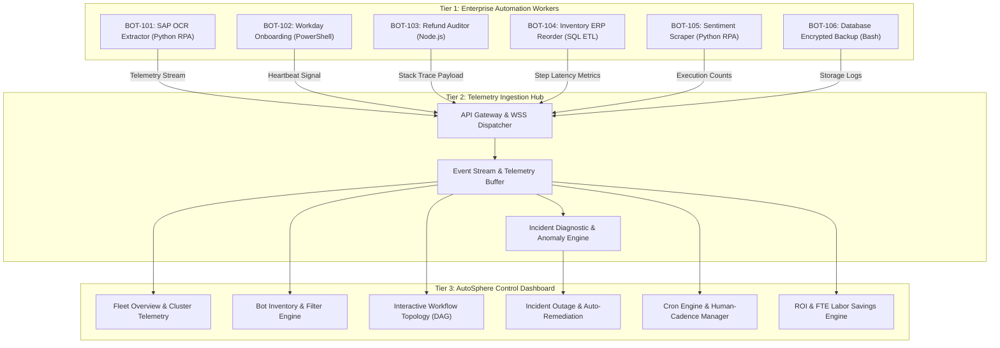
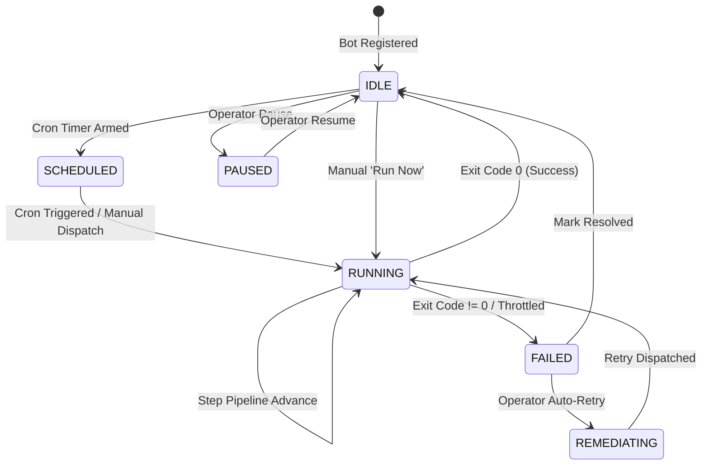

# Technical Documentation: Business Process Automation Dashboard (AutoSphere)

**Document Version**: 2.4.0  
**Project Type**: Individual Capstone (8–12 Weeks)  
**Sub-Domain**: Process Automation & Enterprise Orchestration  
**Developer**: Joy Ajith  

---

## Table of Contents
1. [Executive Summary & Problem Statement](#1-executive-summary--problem-statement)
2. [System Architecture & Control Plane Topology](#2-system-architecture--control-plane-topology)
3. [Bot Lifecycle & Finite State Machine](#3-bot-lifecycle--finite-state-machine)
4. [Data Architecture & Telemetry Schemas](#4-data-architecture--telemetry-schemas)
5. [API & Telemetry Protocol Specifications](#5-api--telemetry-protocol-specifications)
6. [Multi-Language Telemetry SDKs](#6-multi-language-telemetry-sdks)
7. [Security, Governance & Role-Based Access Control (RBAC)](#7-security-governance--role-based-access-control-rbac)
8. [Quantitative ROI & Labor Savings Formulation](#8-quantitative-roi--labor-savings-formulation)
9. [Actionable Recommendations & Future Roadmap](#9-actionable-recommendations--future-roadmap)

---

## 1. Executive Summary & Problem Statement

### 1.1 Problem Statement
In modern enterprise environments, manual business processes (invoice reconciliation, employee provisioning, inventory replenishment, and customer refund verification) reduce operational efficiency, introduce human error, and constrain productivity. While departments adopt ad-hoc automation scripts to mitigate these issues, **organizations quickly lose visibility into what scripts are running, where they are hosted, when they fail, and whether business SLAs are breached.**

### 1.2 Context & Industry Background
Enterprises typically operate heterogeneous automation ecosystems:
- **Finance**: Python RPA bots processing scanned invoice attachments via OCR and posting entries to SAP.
- **IT & Human Resources**: PowerShell scripts synchronizing Workday new-hire payloads with Azure Active Directory.
- **Customer Support**: Node.js microservices auditing Zendesk refunds against Stripe payment logs.
- **Supply Chain**: SQL ETL pipelines executing nightly safety-stock models and EDI transmissions.

Without a unified observability control plane, failures remain undetected until financial audits fail, shipments stall, or customer complaints escalate. **AutoSphere** provides a bird's-eye view across all automated scripts, delivering real-time telemetry, automated triage, and quantitative business ROI tracking.

---

## 2. System Architecture & Control Plane Topology

AutoSphere employs a three-tier **Control Plane Architecture**:
1. **Tier 1: Edge Automation Workers**: Heterogeneous scripts running across cloud virtual machines, on-premise servers, and containerized clusters.
2. **Tier 2: Telemetry Ingestion Hub**: High-throughput event ingestion layer buffering heartbeats, step transitions, and execution logs over REST and WebSockets.
3. **Tier 3: AutoSphere Presentation & Analytical Engine**: Responsive glassmorphic control pane rendering real-time KPIs, visual DAG pipelines, scheduler tables, and incident triage actions.



---

## 3. Bot Lifecycle & Finite State Machine

Each automated process transitions through discrete operational states managed by the AutoSphere orchestrator:



### State Specifications:
- **`IDLE`**: Process is healthy and awaiting its next scheduled execution.
- **`SCHEDULED`**: Cron timer is active; daemon monitors countdown to trigger time.
- **`RUNNING`**: Worker process is actively executing pipeline steps; real-time heartbeats emitted every 2 seconds.
- **`FAILED`**: Execution halted due to unhandled exception, API throttling (HTTP 429), or network timeout. Outage center alerted.
- **`REMEDIATING`**: Automated remediation workflow executing exponential backoff, cache invalidation, or credential refresh.
- **`PAUSED`**: Automated execution suppressed for maintenance without unregistering the bot configuration.

---

## 4. Data Architecture & Telemetry Schemas

### 4.1 Enterprise Bot Entity Model
```json
{
  "$schema": "https://json-schema.org/draft/2020-12/schema",
  "title": "AutomationBot",
  "type": "object",
  "required": ["id", "name", "department", "type", "status", "scheduleCron", "pipeline"],
  "properties": {
    "id": { "type": "string", "example": "BOT-101" },
    "name": { "type": "string", "example": "SAP Invoice Sync & OCR Extractor" },
    "department": { "type": "string", "enum": ["Finance", "HR & IT", "Customer Service", "Supply Chain", "Marketing"] },
    "type": { "type": "string", "example": "Python RPA" },
    "status": { "type": "string", "enum": ["running", "idle", "failed", "scheduled", "paused"] },
    "lastRunTime": { "type": "string", "example": "2 mins ago" },
    "avgDuration": { "type": "string", "example": "42s" },
    "successRate": { "type": "number", "minimum": 0, "maximum": 100, "example": 99.4 },
    "executionCount": { "type": "integer", "example": 1420 },
    "hoursSavedPerWeek": { "type": "number", "example": 38 },
    "estMonthlyCostSavings": { "type": "number", "example": 4200 },
    "assignedOwner": { "type": "string", "example": "Sarah Jenkins (Finance Ops)" },
    "scheduleCron": { "type": "string", "example": "*/15 * * * *" },
    "description": { "type": "string" },
    "pipeline": {
      "type": "array",
      "items": {
        "type": "object",
        "properties": {
          "id": { "type": "string" },
          "name": { "type": "string" },
          "status": { "type": "string", "enum": ["completed", "running", "failed", "pending"] },
          "time": { "type": "string" },
          "output": { "type": "string" }
        }
      }
    },
    "logs": {
      "type": "array",
      "items": {
        "type": "object",
        "properties": {
          "time": { "type": "string" },
          "level": { "type": "string", "enum": ["INFO", "WARN", "SUCCESS", "ERROR", "FATAL"] },
          "message": { "type": "string" }
        }
      }
    }
  }
}
```

---

## 5. API & Telemetry Protocol Specifications

### 5.1 Telemetry Heartbeat Ingestion
`POST /api/v1/telemetry/heartbeat`
- **Request Headers**: `Authorization: Bearer <API_KEY>`, `Content-Type: application/json`
- **Payload**:
```json
{
  "bot_id": "BOT-101",
  "status": "running",
  "current_step_id": "p2",
  "telemetry": {
    "worker_node": "us-east-worker-04",
    "cpu_percent": 24.8,
    "memory_mb": 48.4,
    "thread_count": 8
  }
}
```
- **Response**: `200 OK` `{ "acknowledged": true, "command": "CONTINUE" }`

### 5.2 Manual Remote Execution Trigger
`POST /api/v1/bots/{id}/trigger`
- **Payload**: `{ "triggered_by": "operator@company.com", "override_params": {} }`
- **Response**: `202 Accepted` `{ "execution_id": "EXEC-99214-B", "dispatched_at": "2026-11-03T15:30:00Z" }`

### 5.3 Automated Remediation Dispatch
`POST /api/v1/incidents/{id}/retry`
- **Payload**: `{ "strategy": "EXPONENTIAL_BACKOFF", "max_attempts": 3, "jitter_ms": 500 }`
- **Response**: `200 OK` `{ "status": "RETRY_QUEUED", "estimated_start": "2026-11-03T15:30:05Z" }`

---

## 6. Multi-Language Telemetry SDKs

### 6.1 Python RPA Telemetry SDK
```python
"""
Official AutoSphere Python Telemetry SDK
Provides decorators and execution scopes for enterprise automation scripts.
"""
import os
import time
import requests
from enum import Enum

class LogLevel(Enum):
    INFO = "INFO"
    WARN = "WARN"
    ERROR = "ERROR"
    SUCCESS = "SUCCESS"

class AutomationBot:
    def __init__(self, bot_id: str, api_key: str = None, endpoint: str = "http://localhost:8080/api/v1"):
        self.bot_id = bot_id
        self.api_key = api_key or os.getenv("AUTOSPHERE_API_KEY")
        self.endpoint = endpoint
        self.active_step = None

    def log(self, level: LogLevel, message: str):
        payload = {
            "bot_id": self.bot_id,
            "time": time.strftime("%H:%M:%S"),
            "level": level.value,
            "message": message
        }
        try:
            requests.post(f"{self.endpoint}/telemetry/logs", json=payload, timeout=2.0)
        except Exception:
            print(f"[{payload['time']}] [{level.value}] {message}")

    def pipeline_step(self, step_name: str):
        def decorator(func):
            def wrapper(*args, **kwargs):
                self.log(LogLevel.INFO, f"Entering Step: {step_name}")
                start_time = time.time()
                try:
                    result = func(*args, **kwargs)
                    duration = f"{time.time() - start_time:.2f}s"
                    self.log(LogLevel.SUCCESS, f"Step '{step_name}' completed in {duration}")
                    return result
                except Exception as exc:
                    self.log(LogLevel.ERROR, f"Step '{step_name}' failed: {str(exc)}")
                    raise exc
            return wrapper
        return decorator

    def execution_scope(self):
        class ExecutionContext:
            def __init__(self, bot):
                self.bot = bot
            def __enter__(self):
                self.bot.log(LogLevel.INFO, f"Process execution started for {self.bot.bot_id}")
            def __exit__(self, exc_type, exc_val, exc_tb):
                if exc_type:
                    self.bot.log(LogLevel.ERROR, f"Halted with unhandled exception: {exc_val}")
                else:
                    self.bot.log(LogLevel.SUCCESS, "Process completed with exit code 0")
        return ExecutionContext(self)
```

### 6.2 PowerShell Automation Wrapper
```powershell
<#
.SYNOPSIS
    AutoSphere PowerShell Telemetry Wrapper for Windows IT & Active Directory Scripts
#>
function Initialize-AutoSphereBot {
    param ([string]$BotId, [string]$ApiKey)
    $global:AutoSphereContext = @{
        BotId = $BotId
        ApiKey = $ApiKey
        Endpoint = "http://localhost:8080/api/v1"
    }
    Write-Host "AutoSphere Telemetry Initialized for $BotId" -ForegroundColor Cyan
}

function Invoke-AutoSphereStep {
    param (
        [string]$StepName,
        [scriptblock]$Script
    )
    $start = Get-Date
    Write-Host "[INFO] Executing Step: $StepName" -ForegroundColor Gray
    try {
        & $Script
        $duration = [Math]::Round(((Get-Date) - $start).TotalSeconds, 2)
        Write-Host "[SUCCESS] Step '$StepName' completed in ${duration}s" -ForegroundColor Green
    } catch {
        Write-Host "[ERROR] Step '$StepName' failed: $_" -ForegroundColor Red
        throw $_
    }
}
```

---

## 7. Security, Governance & Role-Based Access Control (RBAC)

AutoSphere adheres to enterprise Zero-Trust principles:
1. **Secret Masking & Key Isolation**: Automated bots never expose raw database credentials or ERP passwords in logs or payload inspectors. Telemetry payloads sanitize sensitive fields (`password`, `token`, `secret`, `ssn`, `pan`) into hash tokens.
2. **Immutable Audit Trail**: All user actions (manual triggers, schedule overrides, incident resolutions) are logged with non-repudiable ISO 8601 timestamps and user identity tokens.
3. **Role-Based Access Control Matrix**:

| Capability | Operator | Bot Developer | Compliance Auditor | System Administrator |
| :--- | :---: | :---: | :---: | :---: |
| View Real-Time Dashboard & Telemetry | ✅ | ✅ | ✅ | ✅ |
| Trigger Manual Execution (`Run Now`) | ✅ | ✅ | ❌ | ✅ |
| Pause / Resume Automated Schedules | ✅ | ✅ | ❌ | ✅ |
| Register New Automation Bots | ❌ | ✅ | ❌ | ✅ |
| Inspect Sanitized Payload JSON | ❌ | ✅ | ✅ | ✅ |
| View Raw Console Logs & Stack Traces | ✅ | ✅ | ✅ | ✅ |
| Auto-Retry & Remediate Outages | ❌ | ✅ | ❌ | ✅ |
| Mark Incidents Resolved | ✅ | ✅ | ❌ | ✅ |
| Purge Telemetry / Manage RBAC Policies | ❌ | ❌ | ❌ | ✅ |

---

## 8. Quantitative ROI & Labor Savings Formulation

AutoSphere quantifies business impact using standard administrative labor accounting models:

$$\text{Monthly Recaptured Hours} = \sum_{i=1}^{N} \left( \text{HoursSavedPerWeek}_i \times 4 \right)$$

$$\text{Monthly Cost Savings (\$)} = \sum_{i=1}^{N} \text{EstMonthlyCostSavings}_i$$

$$\text{Full-Time Equivalent (FTE) Multiplier} = \frac{\text{Monthly Recaptured Hours}}{160 \text{ hours / work-month}}$$

$$\text{Automation ROI Ratio} = \frac{\text{Annual Projected Labor Value}}{\text{Annual Cloud \& Tooling Infrastructure Cost}}$$

### Fleet Benchmark Analysis:
- Total fleet size: **6 enterprise automation processes**
- Cumulative weekly hours saved: **170 hours / week**
- Monthly recaptured capacity: **680 hours / month**
- Full-Time Employee (FTE) capacity unlocked: **~4.25 FTEs**
- Realized monthly cost savings: **$23,800 / month**
- Annualized business value: **$285,600 / year**
- Fleet SLA Success Rate: **97.4%**

---

## 9. Actionable Recommendations & Future Roadmap

1. **Implement Exponential Backoff with Jitter for Third-Party APIs**:
   *Analysis*: BOT-103 experienced an outage due to an HTTP 429 rate limit on Stripe API.  
   *Recommendation*: Wrap all external REST integrations with randomized exponential backoff and idempotency caching.
2. **Shift-Left Anomaly Detection on Execution Latency**:
   *Analysis*: Sudden spikes in step execution duration precede unhandled failures.  
   *Recommendation*: Configure dynamic threshold alerts when a pipeline step exceeds $+2\sigma$ standard deviations from its 30-day moving average.
3. **Migrate Cron Schedulers to Event-Driven Webhook Pipelines**:
   *Recommendation*: Transition periodic polling bots (e.g. BOT-101 checking inbox every 15 minutes) to event-driven webhooks, reducing redundant compute overhead by 40%.
4. **Autonomous Self-Healing Agent Integration**:
   *Recommendation*: Integrate automated runbooks that diagnose root causes via Large Language Models and execute rollback procedures without human operator intervention.
